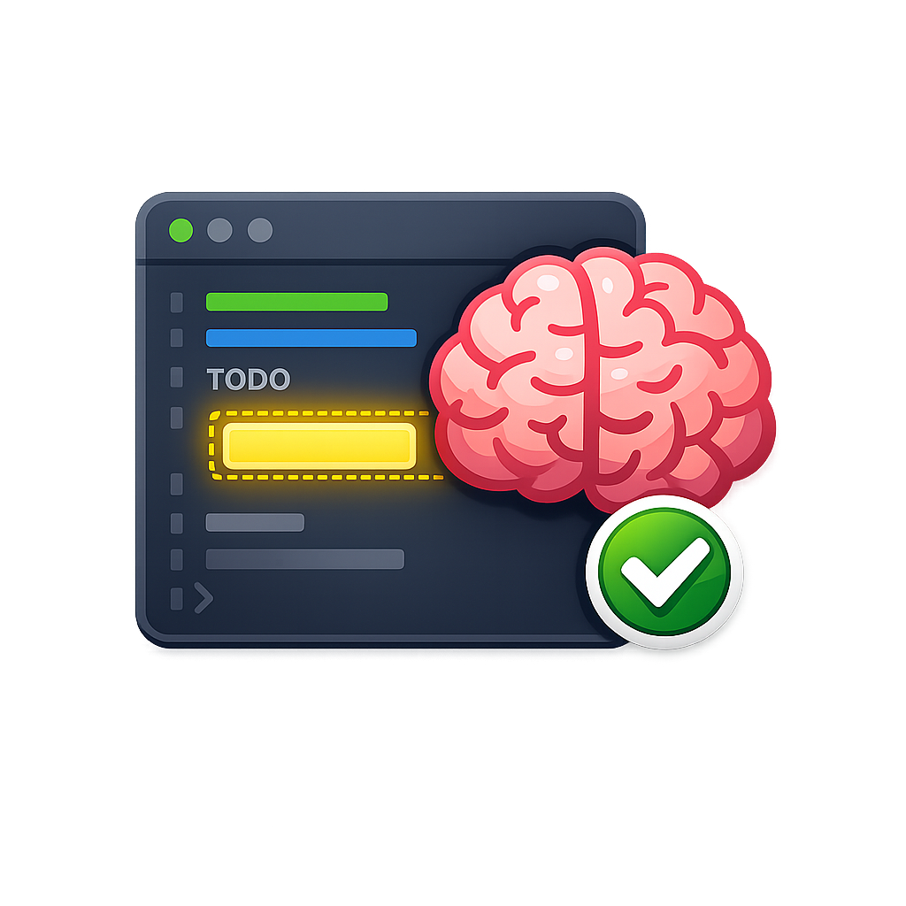

<p align="center">
  
</p>

## Brain-First: AI writes the routine code, you write the code that matters

<p align="center"><a href="README.md">中文</a> | English</p>

<p align="center">
  <a href="https://github.com/AlniyatYang/brain-first/blob/main/LICENSE"></a>
  <a href="https://agentskills.io/specification"></a>
  <a href="https://github.com/AlniyatYang/brain-first"></a>
  <a href="https://github.com/AlniyatYang/brain-first"></a>
  <a href="https://github.com/AlniyatYang/brain-first"></a>
  <a href="https://github.com/AlniyatYang/brain-first"></a>
</p>

> **Every programmer on Earth got 100× worse. I didn't.**

## Prologue: a story about the brain

There once was a programmer who went ten years without AI autocomplete and wrote every line by
hand. The team treated him as a living fossil: colleagues shipped three features a day with AI
while he shipped one every three days. A handwritten note from his mentor was stuck to his
monitor: "Every line of code goes through your own brain."

Then one day every AI coding service in the world went down at once. Every screen on the floor
turned red; everyone kept clicking retry, muttering "it'll be back any minute". The one screen
still green belonged to the man who wrote code by hand. He grabbed a stack trace, set a
breakpoint, found a lock-ordering bug buried in the middle of a call chain, and fixed a trading
system handling thirty thousand orders per second in ten minutes.

The outage exposed an awkward truth: many programmers' skills had been quietly eroding. Some
needed AI to write a for loop or a binary search. Not because they weren't smart, but because
once searching, designing and debugging were outsourced for long enough, the brain stopped
using those circuits. The story pushes this to an extreme; the outage only revealed what had
already happened.

We're not predicting a disaster. The point is simple: **tools are the road, skill is the legs.
However good the road gets, don't sell your legs.** While AI works fine is exactly the time to
train.

brain-first turns that lesson into an executable protocol: AI does the routine work (builds the
road), you hand-write key decisions and core algorithms (train the legs), and then you explain
what you wrote (it goes through your brain).

## Features

- **Hand over the key code**: AI handles routine work (scaffolding, wiring, boilerplate,
  peripheral config); design decisions, business logic with several valid approaches, key
  algorithms and interface definitions are left for you to write (2-10 lines at a time)
- **The `TODO(human)` contract**: before asking, AI writes a `TODO(human)` placeholder in your
  codebase, and only one exists at a time, so you always know exactly which piece is yours
- **Your code gets checked**: when you're done, AI reads your code and runs the build/tests if it
  can. If something's wrong you get a hint, not a rewrite; the marker is removed only once it passes
- **Teaching points**: one after each step passes its check, 2-3 when the whole task is done
  (what problem it solves, the key trade-off, where else it applies). No lecture every turn
- **Opening protocol**: learning/migration tasks start with a concept map and a step overview
  (each step marked as AI's or yours); nothing is edited until you confirm
- **Pacing and checks**: one step per turn; each step ends with a single question to confirm you
  understood. If you can't answer, it gets explained on the spot
- **Exit any time**: say "back to normal mode" to stop practice mode

## How it works

A typical brain-first session:

1. Learning/migration tasks start with the opening protocol: concept map + step overview, then wait for your confirmation
2. AI implements step by step, doing routine parts itself; at key decision points (or operations you said you want to learn) it first writes a `TODO(human)` placeholder
3. AI asks you to implement 2-10 lines using a three-part request: **Context / Your task / Hints**
4. After asking, AI stays silent and waits; it doesn't do it for you or keep going
5. When you're done, AI reads and (where possible) builds/tests your code; if there's a problem you get a hint to fix it yourself; once it passes, `TODO(human)` is removed
6. Each step ends with one check question; a correct answer earns one teaching point, a wrong one gets a full explanation
7. When all steps are done, AI summarizes 2-3 teaching points linking your code to broader patterns

Output uses plain CommonMark (headings, blockquotes, bold), so it renders the same in every
agent with no per-tool customization.

> Note: the skill's instructions and its messages to you are written in Chinese. Agents generally
> follow the language you write in, but expect some Chinese headings.

## Use cases

- Guided project migration: e.g. MyBatis → MyBatis-Plus, AI paves the road and you change the key parts
- Interview prep: practice "AI off, write it by hand" rounds
- Rebuilding hands-on skill after a long stretch of letting AI generate everything
- Learning a new framework: AI builds the skeleton, you write the core business logic

## Supported agents

| Agent | Global directory |
|---|---|
| Claude Code | `~/.claude/skills/brain-first/` |
| Kimi Code | `~/.kimi-code/skills/brain-first/` |
| Codex | `~/.codex/skills/brain-first/` |
| OpenCode | `~/.config/opencode/skills/brain-first/` (also reads `~/.claude/skills/`; no separate install needed if Claude Code is installed) |

> Install once per agent. Codex, Kimi Code and OpenCode also read the shared `~/.agents/skills/`
> directory; putting a copy in several directories makes the skill load more than once.

Works with any agent that supports `SKILL.md` per the
[Agent Skills specification](https://agentskills.io/specification).

## Triggering

- **Automatic**: say things like "learning mode", "hands-on practice", "let me write it myself"
  (Chinese: 学习模式 / 边写边学 / 自己动手写); the model loads the skill from its `description`
- **Manual**: in a new session, type `/brain-first`

## Installation

### Option 1: install script (recommended)

```bash
git clone https://github.com/AlniyatYang/brain-first.git && cd brain-first
./install.sh                # detect installed agents, create skills dirs, install (idempotent)
./install.sh --uninstall    # uninstall
```

The script detects agents by whether `~/.claude`, `~/.codex`, `~/.kimi-code` or
`~/.config/opencode` exists, installs one copy per agent, and cleans up copies older versions
left in `~/.agents/skills/`.

On Windows, run it in Git Bash (from PowerShell: `bash install.sh`).

### Option 2: copy manually

Run only the line for the agent you use (running all of them causes duplicate loading):

```bash
mkdir -p ~/.claude/skills && cp -r skills/brain-first ~/.claude/skills/
mkdir -p ~/.kimi-code/skills && cp -r skills/brain-first ~/.kimi-code/skills/
mkdir -p ~/.codex/skills && cp -r skills/brain-first ~/.codex/skills/
mkdir -p ~/.config/opencode/skills && cp -r skills/brain-first ~/.config/opencode/skills/
```

### Option 3: skills CLI

With the [skills CLI](https://github.com/vercel-labs/skills), which detects installed agents:

```bash
npx skills add AlniyatYang/brain-first -g
```

Start a **new session** after installing.

## Repository layout

```
brain-first/
├── README.md                     # Chinese
├── README.en.md                  # English
├── CHANGELOG.md
├── LICENSE                       # MIT
├── install.sh                    # multi-agent install/uninstall
├── assets/
│   └── logo.png
├── scripts/
│   └── validate_skill.py         # validates SKILL.md frontmatter and spec constraints
├── .github/workflows/ci.yml      # CI: shellcheck + skill validation + installer smoke test
└── skills/
    └── brain-first/
        ├── SKILL.md              # core instructions (Agent Skills spec, Chinese)
        └── references/
            └── examples.md       # full request examples (partial function / debugging / project migration)
```

## Development

- `name` must match the folder name; bump `metadata.version` after behavior changes and record it in `CHANGELOG.md`
- Keep SKILL.md lean (<500 lines / 5k tokens); put details in `references/`
- Update both `README.md` and `README.en.md` when behavior changes
- Validate locally before committing:

```bash
python3 scripts/validate_skill.py && shellcheck install.sh
```

## License

MIT
