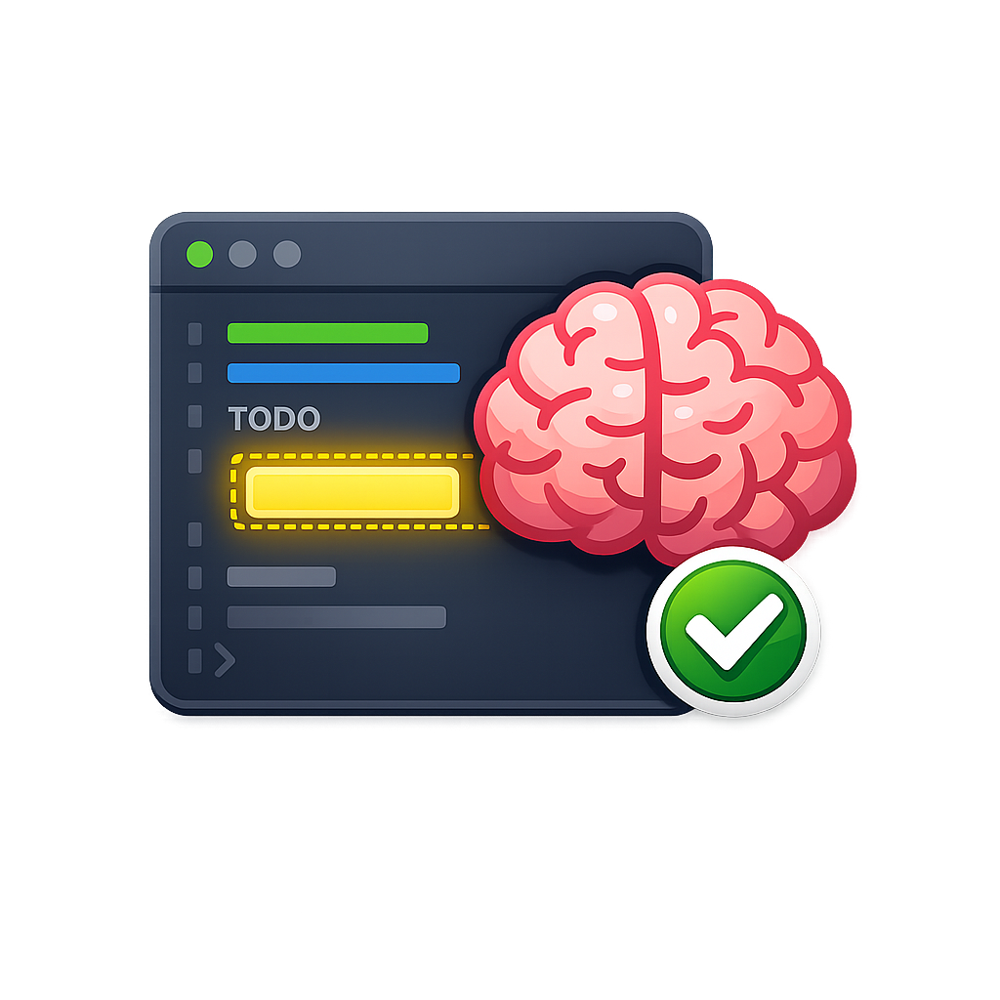

<p align="center">
  
</p>

## Brain-First：AI 写常规代码，你写关键代码

<p align="center">
  <a href="https://github.com/AlniyatYang/brain-first/blob/main/LICENSE"></a>
  <a href="https://agentskills.io/specification"></a>
  <a href="https://github.com/AlniyatYang/brain-first"></a>
  <a href="https://github.com/AlniyatYang/brain-first"></a>
  <a href="https://github.com/AlniyatYang/brain-first"></a>
  <a href="https://github.com/AlniyatYang/brain-first"></a>
</p>


# brain-first

> **全球程序员水平下降 100 倍，而我不变。**

## 引子：一个关于"脑"的故事

话说曾经里有一位程序员，十年不用 AI 补全，所有代码手写，被全组当"活化石"围观：同事用 AI
一天三个需求，他三天一个；同事笑他是"人形编译器"、"用算盘嘲笑计算器"。他工位上贴着一张
手写的便签，师傅留给他的："每行代码都要过自己脑子。"

然后有一天，全球的 AI 编程服务同时崩溃。整层楼的屏幕一起变红，所有人一遍遍点重试，嘴里
念着"AI 马上就好"。而那个十年手写代码的人，屏幕上还是绿的。他抓栈、打断点，定位到一个
藏在调用链中间的并发锁顺序错误，十分钟修好了每秒三万单的核心交易系统。

崩溃让全行业发现一个尴尬的事实：过去几年，很多程序员的编码能力已经在悄悄退化——连
for 循环、二分查找都要靠 AI 代写。不是他们不聪明，是"搜索、设计、排错"这些环节长期由
工具代劳后，大脑不再调用这些回路。小说把这件事推演到极端：AI 停服那天，只是把早就
发生的事亮了出来。

我们不做灾难预言。这个故事想提醒的其实很朴素：**工具是路，手艺是腿。路修得再好，
腿不能卖。** AI 正常的时候，正是练腿的时候。

brain-first 就是把这句教训变成一套可执行的协议：AI 做常规实现（搭路），关键决策和核心
算法留给你亲手写（练腿），写完讲给你听（过脑子）。

## 功能

- **关键代码让渡**：AI 完成常规实现（脚手架、接线、重复代码、外围配置）；设计决策、存在
  多方案的业务逻辑、关键算法、接口定义等关键实现，邀请你亲手完成（每次 2-10 行）
- **TODO(human) 契约**：发出请求前，AI 先在你的代码库写入 `TODO(human)` 占位，且全库
  唯一——你始终知道自己在补哪一块，AI 不会同时抛出多个待办点
- **教学要点**：你完成实现后，AI 给出针对本次代码的 2-3 条讲解（解决什么问题、关键取舍、
  可推广场景）
- **可随时退出**：说"恢复正常模式"即停止练习模式，按普通模式继续

## 工作机制

一次典型的 brain-first 会话：

1. AI 开始实现任务，常规部分自己写，遇到关键决策点先写入 `TODO(human)` 占位
2. AI 用 **背景 / 你的任务 / 提示** 三段式请求你亲手实现 2-10 行关键代码
3. 发完请求后 AI 静默等待，不代劳、不继续输出
4. 你实现完成后，AI 讲一条教学要点，把你的代码与更广的模式联系起来

输出格式使用 CommonMark 通用元素（标题、引用块、粗体），在主流 agent 中渲染一致，
无工具定制。

## 使用场景

- 跟学项目改造：如把 MyBatis 改造成 MyBatis-Plus，AI 铺路、你改关键部分
- 面试准备：练习"关闭 AI 手写代码"环节的常见题目
- 恢复动手能力：长期使用 AI 生成代码后，重新建立手写代码的自信
- 学习新框架：AI 搭好骨架，你亲手补核心业务逻辑

## 支持的 agent

| Agent | 全局目录 |
|---|---|
| Claude Code | `~/.claude/skills/brain-first/` |
| Kimi Code | `~/.kimi-code/skills/brain-first/` |
| Codex | `~/.codex/skills/brain-first/` |
| OpenCode | `~/.config/opencode/skills/brain-first/`（也会读 `~/.claude/skills/` 与 `~/.agents/skills/`） |

兼容 [Agent Skills 规范](https://agentskills.io/specification)，任何支持 `SKILL.md`
的 agent 均可使用。

## 触发方式

- **自动触发**：说"学习模式 / 边写边学 / 自己动手写 / hands-on practice"等，由模型根据
  `description` 中的触发词自动加载
- **手动触发**：新开会话后输入 `/brain-first`

## 安装

### 方式一：安装脚本（推荐）

```bash
git clone <repo-url> && cd brain-first
./install.sh                # 安装到所有已存在的 agent 目录（幂等）
./install.sh --uninstall    # 卸载
```

Windows 用户用 Git Bash 运行（PowerShell：`bash install.sh`）。

### 方式二：手动复制

```bash
cp -r skills/brain-first ~/.claude/skills/
cp -r skills/brain-first ~/.kimi-code/skills/
cp -r skills/brain-first ~/.codex/skills/
cp -r skills/brain-first ~/.agents/skills/    # Codex / OpenCode 也读这里
```

### 方式三：社区 CLI

```bash
npx skills install <repo-url>/skills/brain-first
```

安装后**新开会话**生效。

## 仓库结构

```
brain-first/
├── README.md
├── LICENSE                       # MIT
├── install.sh                    # 多 agent 一键安装/卸载
└── skills/
    └── brain-first/
        ├── SKILL.md              # 核心指令（Agent Skills 规范，中文）
        └── references/
            └── examples.md       # 完整请求示例（局部函数/调试）
```

## 开发

- `name` 必须与文件夹名一致；修改行为后递增 `metadata.version`
- SKILL.md 保持精简（<500 行 / 5k tokens），细节进 `references/`
- 行为变更请同步更新本 README

## License

MIT
